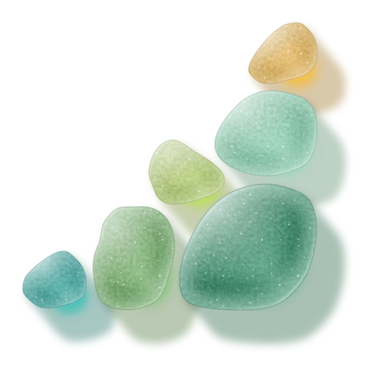

# Fieldwise brand kit

The Fieldwise identity and everything built from it.

- **Brand kit** (logo, colour, type, applications, water lab): https://fieldwise-brand-kit.vercel.app
- **Emails** (templates, gallery and the writing guide): https://fieldwise-brand-kit.vercel.app/email/



**The mark** is No. 06, "Gathered": six pieces of sea glass placed into a right triangle, with the right angle at the bottom right, in the Field glass set (greens from bottle to lime). The tagline is "Grow where it counts."

## What's here

| Folder | What it is |
|---|---|
| `kit/` | The brand-kit site: logo, colour, type, applications and the water lab. `export.js` renders every download (logo files and application artwork). |
| `lab/` | The logo lab: `pebbles.js` (the sea-glass renderer), `layouts-all.js` (all 19 explored marks; No. 06 is `nine-432`), and `arrange.js`/`gen.js` (stone generation) |
| `email/` | The email system: 24 templates as JSON specs, the block renderer, `draft.js`, `mockup.js`, and [the guide](email/GUIDE.md) |
| `.claude/skills/fieldwise-email/` | A Claude Code skill that drafts emails through the guide |

## Using it

```bash
npm install                    # Playwright, used for renders, previews and screenshots (needs Chrome)
cd email
node draft.js templates/cold-1-first-touch.json --sample --png    # build an email from a template
open ../kit/index.html         # the brand kit runs locally from the files
```

To write an email, read [email/GUIDE.md](email/GUIDE.md). It's written so a person or an AI agent can follow it step by step.

## Publishing

`sh publish.sh` assembles `deploy/` and deploys it to the brand-kit Vercel project. It needs access to that project.

## Usage

The Fieldwise name, mark and tagline identify Fieldwise. Please don't use them for other businesses. The code (renderer, email system, scripts) is free to learn from and adapt.
