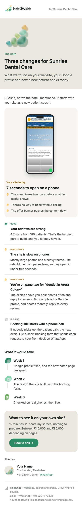
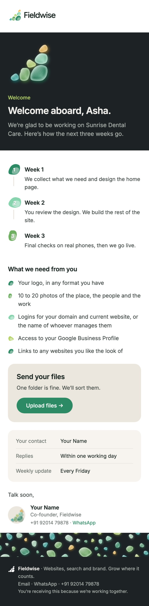

# How to write a Fieldwise email

This guide is for anyone writing a Fieldwise email: a person, or an AI agent working in this repo. Follow it from top to bottom the first time. After that, the checklist at the end is enough.

**Short version:** don't write email HTML by hand, and don't paste plain text. Copy the closest spec in `templates/`, rewrite its words for the person you're writing to, and run `node draft.js`. The tool builds the email from tested pieces in the brand's look, checks it, and gives you a file that's ready to send.

| A finished email | |
|---|---|
|  |  |

More finished samples are in the gallery: https://fieldwise-brand-kit.vercel.app/email/

---

## 1. What makes these emails look like a real company's

Polished emails from product companies follow a few rules. Ours are built in:

1. **One idea, one ask.** Every email has a single job (book a call, open the preview, pay the invoice) and one main button for it.
2. **A visual that carries meaning, not decoration.** The glass mark in the hero is the brand. The phone screenshot shows *their* site. Numbered stones show *their* timeline. Screenshots of our work prove we can do it.
3. **A clear order.** Hero (what this is), short greeting, the substance (visual blocks), the ask, sign-off from a real person.
4. **Short lines and lots of space.** Paragraphs of one to three sentences, panels that group related things, and nothing crammed together.
5. **The same pieces every time.** Same header, same stones, same green button, same footer. That consistency is what makes it feel like a brand.
6. **It works everywhere.** Gmail, Apple Mail, Outlook and phones, in light and dark mode. The renderer handles this, so never edit the HTML by hand.

## 2. The workflow (people and agents)

```bash
cd brand/email

# 1. pick the closest template and copy it
mkdir -p drafts
cp templates/cold-5-the-note.json drafts/acme-note.json

# 2. (optional) capture their website for the phone/browser blocks
node mockup.js https://acme-example.in acme          # -> assets/u/acme-phone.png, assets/u/acme-desktop.jpg

# 3. edit drafts/acme-note.json: rewrite the words, keep the block structure

# 4. build it, with the values for the {{tags}}
node draft.js drafts/acme-note.json --data drafts/acme-values.json --png --eml --to owner@acme-example.in

# 5. read the checks it prints, fix, run again until "✓ no issues"
# 6. open drafts/acme-note.png to look at it, then send (section 7)
```

`drafts/` and `assets/u/` are git-ignored, because they hold real people's details.

### For AI agents: the rules

- **Always go through `draft.js`.** Never hand-write or hand-edit email HTML, and never send the `.txt` file as the email.
- **Start from a template spec.** Keep its block order unless the email clearly needs something else; then pick blocks from section 4.
- **Rewrite every sentence for this person and business.** The samples are about a dental clinic called Sunrise Dental Care (Asha, Bhopal, "patients"). `draft.js` warns if sample wording is left in. Resolve every warning.
- **Fill every `{{tag}}`.** Unfilled tags are an error. Put values in a `--data` JSON file or pass `--set key=value`.
- **Never invent facts.** That includes numbers, results, client names and quotes. Only use proof that appears in this guide (section 6) or that the user gave you. If you don't know a value (load time, rating), find it (section 8) or leave that block out.
- **Look at the result.** Run with `--png` and view the image before you call it done.
- **Keep the user in the loop for sending.** Create a draft (section 7). Don't send unless the user said to.

## 3. Choosing the template

| Situation | Template | Kind |
|---|---|---|
| First email to a business that doesn't know us | `cold-1-first-touch` | letter |
| No reply after 3 days (same thread) | `cold-2-follow-up` | letter |
| No reply after 7 days (new thread, give a free fix) | `cold-3-free-tip` | letter |
| No reply after 14 days (last one) | `cold-4-last-note` | letter |
| They said "yes, send the note" | `cold-5-the-note` | branded |
| They're interested / ask price / want details / not now / wrong person | `reply-interested`, `reply-pricing`, `reply-send-info`, `reply-not-now`, `reply-wrong-person` | letter |
| Someone filled the website form | `enquiry-reply` | letter |
| A call got booked | `call-confirmed` | branded |
| Sending a proposal / chasing it | `proposal`, `proposal-follow-up` | branded / letter |
| Project starts | `welcome` | branded |
| Friday update during a project | `project-update` | branded |
| Launch day | `launch` | branded |
| Invoice / reminder / payment received | `invoice`, `payment-reminder`, `payment-received` | branded / letter / branded |
| Monthly report for care-plan clients | `monthly-report` | branded |
| Asking for a Google review | `review-request` | branded |
| Monthly newsletter | `newsletter` | branded |
| Need a block that isn't in your template | copy it from `all-blocks` | |

**Two kinds:**

- **`letter`** reads like a person wrote it in Gmail: white page, no logo header. It can still hold visual blocks (work, features, a note, a phone screenshot) and ends with the photo signature. Use it for cold emails, replies, follow-ups and anything that should feel personal.
- **`branded`** is the full brand: logo header, hero or banner, panels, and a footer with the mark (`"footer": "dark"` adds the glowing stone band). Use it for anything a client keeps: the note, proposals, welcome, updates, launch, invoices, reports and newsletters.

## 4. Blocks

A spec is JSON:

```json
{
  "id": "acme-note",
  "kind": "branded",
  "group": "cold",
  "subject": "The note for {{company}}",
  "preheader": "Three changes, in the order we’d make them.",
  "label": "for {{company}}",
  "footer": "light",
  "blocks": [ { "type": "hero", "title": "…" }, { "type": "text", "text": "…" } ]
}
```

- `subject`: under 60 characters, no exclamation marks, no capitals for emphasis.
- `preheader`: the grey preview line after the subject. 20 to 110 characters, and it should add something new, not repeat the first line.
- `label`: optional; small text at the top right of a branded email.
- `footer`: `"light"` (default) or `"dark"`.
- `unsubscribe: true`: required for newsletters and anything sent to a list.

Text fields accept `<b>`, `<a href="…">` and `<br>`. Every block type, rendered, is in `templates/all-blocks.json` and in the gallery under **every block**.

### Visual blocks: use one or two per email, where they mean something

| Block | Looks like | Use it for | Fields |
|---|---|---|---|
| `hero` | Sand (or slate) band with the glass mark beside a big title | The first block of most branded emails | `title`, `kicker`, `text`, `button {label, href}`, `dark`, `art` (default: the mark; or `sample-new-phone`, `u/<name>-phone`) |
| `banner` | Full-width band of sea-glass stones | Opening reports and newsletters | `src`: `banner-welcome`, `banner-live`, `banner-proposal`, `banner-report`, `banner-news`, `banner-thanks` |
| `phone` | A phone screenshot in a sand panel, with a title and stone bullets beside it | Their site today (`tone: "bad"`, amber stones) or their new site | `src`, `alt`, `kicker`, `title`, `text`, `items`, `tone` |
| `image` | A rounded screenshot, optionally linked, with a caption | A preview of their new page, a chart, a design | `src`, `alt` (required), `caption`, `href`, `width` |
| `work` | Our project screenshots in browser frames, with a line each | Proof in cold emails, proposals, newsletters | `title`, `items [{src, title, text, href}]` |
| `steps` | Numbered glass stones joined by a line | Timelines, agendas, what happens next | `items [[title, text]]` (3 is ideal, 4 max) |
| `features` | 2 or 3 columns, each with a stone, title and line | Three things the note covers, three tips | `items [[title, text]]`, `stone` |
| `stats` | A dark full-width band of big numbers | Launch results, headline outcomes | `items [[value, label]]`, `title` |
| `metrics` | Sand cards with a big number and a green change | Monthly reports | `items [[label, value, change]]` |
| `status` | Rows marked good / needs work / missing | Audits ("the note") | `items [[state, title, text]]` where `state` is `good`, `work` or `missing` |
| `progress` | A segmented green bar with stage names | Project updates | `current` (number of stages done), `labels` |
| `cta` | A sand panel with a title, a line, a button and the mark | The main ask, near the end | `title`, `text`, `button {label, href}` |

### Text blocks

| Block | Use |
|---|---|
| `heading` | `level: 1` (default) for the title when there's no hero; `level: 2` for section titles |
| `text` | A paragraph, one to three sentences |
| `list` | Stone bullets; items can be `"text"` or `["Bold title", "text"]`; `stone`: `green` (done), `grey` (next), `amber` (problem), or `mixed` |
| `numbered` | A plain 1, 2, 3 list; best in letters |
| `details` | Label and value rows in a sand panel: times, invoice details, contacts |
| `table` | Line items with prices and a total |
| `note` | One important thing in a panel; `tone: "green"` for good news or a tip |
| `quote` | **A real quote from a real client, with their permission. Never invent one.** |
| `button` | A standalone button; `style: "secondary"` for a quieter one |
| `divider`, `spacer` | Space between sections |
| `signoff` | "Thanks," plus the photo signature (name, role, phone, WhatsApp). Every email ends with it. |
| `ps` | A P.S. line after the signature |

### Images you can use

- **Brand:** `mark-hero`, `mark-hero-glow`, the `banner-*` set, `band`, `band-dark`.
- **Our work:** `work-resort`, `work-offpay`, `work-bus`.
- **Samples, for templates only:** `sample-old-phone`, `sample-new-phone`, `sample-new-desktop`. Replace these with real screenshots before sending.
- **Their site:** `u/<name>-phone` and `u/<name>-desktop`, made with `mockup.js`.
- **Anything else:** any `https://` image URL.

## 5. Recipes

These are the block orders that work. The templates already follow them.

- **Cold, first email (letter):** text greeting → the observation (1–2 short paragraphs) → who we are in one line → `work` (one project, the closest match) → the ask as a question → `signoff` → `ps`.
- **The note (branded):** `hero` → one line → `phone` (their site today, `tone: "bad"`) → `status` (1 good, 2 work, 1 missing) → `heading` 2 → `steps` (3 weeks) → `cta` (book a call, with the price range) → `signoff`.
- **Proposal:** `hero` → thanks line → `table` → `steps` → `cta` (open the proposal) → `work` (two projects) → `signoff`.
- **Welcome:** dark `hero` → `steps` → `list` of what we need → `cta` (upload) → `details` (contact) → `signoff`, with `footer: "dark"`.
- **Weekly update:** `heading` → `progress` → `image` (the preview) → done `list` (green) → next `list` (grey) → `note` (what we need) → `button` → `signoff`.
- **Launch:** `hero` with `art` set to their new site on a phone → `stats` → `steps` → `signoff`, with `footer: "dark"`.
- **Report:** `banner` → `heading` → `metrics` → `list` ×2 → `signoff`.
- **Newsletter:** `banner` → `heading` → 2 `text` → `features` (tips) → `work` → `cta` → `signoff`, with `footer: "dark"` and `unsubscribe: true`.

## 6. Writing rules

**Voice:** plain, warm and specific, like a capable person who respects the reader's time. Sentence case everywhere.

| Don't | Do |
|---|---|
| "I hope this email finds you well." | Start with the point: "I searched ‘dentist in Arera Colony’ this morning." |
| "We are a leading digital agency offering world-class solutions." | "We build fast websites, sort out Google listings and set up bookings that land on WhatsApp." |
| "Your website could be improved." | "Your site takes about 7 seconds to open on a phone." |
| "Let me know if you're interested in a call to discuss synergies." | "Shall I send it over?" |
| "Just checking in!" | "Bringing this back up in case it got buried. The note covers three things:" |
| Three asks and four links | One ask, one button |

- **Length:** first cold emails under about 150 words of text; follow-ups under 80; branded emails as long as the content needs, but every paragraph earns its place.
- **Subjects:** short, specific and lowercase-friendly (`{{company}} on Google`, `One thing for {{company}} this week`). Never use "partnership", "proposal for collaboration", emoji or exclamation marks.
- **Names:** emails come from Fieldwise. The sender's name appears only in the signature.
- **Proof you may use:**
  - **A resort in Indore:** we built the website, online room booking, and event enquiries that go straight to WhatsApp.
  - **OffPay:** 11,700+ people used it in its first eight weeks, and two in three found it through Google search.
  - **Bus ticketing:** seat selection, QR tickets and live tracking.
  - Anything else needs a source the user gave you. Don't name clients beyond these without asking.
- **Words `draft.js` flags:** "hope this finds you well", "reach out", "just checking in", "touch base", "leverage", "synergy", "world-class", "cutting-edge", "seamless", "elevate", "unlock", "game-changer", "kindly", "dear sir/madam".

## 7. Sending

Pick the route you have:

1. **Gmail API or a Gmail tool that accepts raw MIME (best for agents):** run `draft.js … --eml --to <address>`. The `.eml` file holds the HTML, the plain text and any `assets/u/` screenshots as inline images. Create a Gmail **draft** from it: base64url-encode the file and pass it as `message.raw` to `users.drafts.create`. Brand images load from the hosted kit.
2. **A tool that takes an HTML body:** send the contents of `drafts/<id>.html` as the HTML body and `drafts/<id>.txt` (without its first "Subject:" line) as the text body. Screenshots in `assets/u/` must be hosted first (`../publish.sh`), or pass `--inline` and use the `.eml` route instead.
3. **By hand in Gmail:** open `drafts/<id>.html` in Chrome, select all (⌘A), copy, and paste into a new Gmail message. Or use **copy email** in the gallery for a template.
4. **Apple Mail or Outlook:** double-click the `.eml` file, then send it from there.
5. **Mail tools (Brevo, Mailchimp, Instantly):** build with `--keep-tags` and paste the HTML into a custom-code template. Rename `{{tags}}` to the tool's format.

**Cold emails and deliverability:** a brand-new inbox that sends heavy HTML to strangers lands in spam. For the first two weeks of a new sending address, send the cold emails' `.txt` versions, then switch to the letter HTML (it's light: a few small images). The playbook in `cold-outreach.md` covers volume and domains.

**Test before the first real send:** send it to yourself and open it on a phone and in Gmail on the web, in dark mode too.

## 8. Personalising cold emails

The first email works only if the observation is true and specific. For each business:

1. **Search** what a customer would type (service plus area), in an incognito window on a phone. Note where they appear: `{{search_term}}`, `{{observation}}`.
2. **Speed:** run their site through https://pagespeed.web.dev on mobile and round the speed index: `{{load_time}}`.
3. **Google profile:** note the rating, review count, last photo and last owner reply: `{{rating}}`, `{{review_count}}`, `{{quick_win}}`.
4. **Screenshot:** `node mockup.js <their url> <short-name>` gives you `u/<short-name>-phone` for the `phone` block and `u/<short-name>-desktop` for an `image` block.
5. **Three issues:** write the three things a customer would notice on their phone: `{{issue_1}}`…`{{issue_3}}`.

If you can't find a real observation, don't send.

## 9. Checklist before anything goes out

- [ ] It started from a template spec and was built with `draft.js`
- [ ] `draft.js` printed ✓ no issues, or only warnings you've read and accepted
- [ ] Every sentence is written for this business; no sample wording (Asha, Sunrise, patient, clinic)
- [ ] Every number and claim is true and sourced
- [ ] There's one main ask, and the button says exactly what happens ("Book a call", "Open the preview")
- [ ] The subject is under 60 characters and the preheader adds something
- [ ] Images are real for this person (no `sample-*` images left)
- [ ] You looked at the `--png` preview
- [ ] It's saved as a draft for the user unless they said to send

## 10. Brand reference

- **Logo:** mark No. 06 ("Gathered"): six sea-glass stones forming a right triangle, right angle at the bottom right, in the Field glass set. Never redraw, recolour or rearrange it; use the files in `assets/` or the brand kit.
- **Colours:**
  - ink `#18241F`; body text `#3A443E`; muted `#6B746E`
  - page `#F3F1EC`; sand `#ECE7DE`; panel `#F7F4EF`
  - green `#2C8A64` (buttons and links)
  - for dark: slate `#1D2225`, with lime `#B6D46A` accents
- **Type:** Inter (falls back to the system sans).
- **Tagline:** "Grow where it counts."
- **Contact:** fieldwisesolutions1@gmail.com · +91 92014 79878 · WhatsApp wa.me/919201479878
- **Brand kit:** https://fieldwise-brand-kit.vercel.app

## 11. Changing the system

- **Add or change a template:** edit `templates/<id>.json` (and `sample.json` for its tags), then run `node build.js`. The build fails on errors.
- **Add a block type:** add it to `BLOCKS` in `lib/render.js`, add an example to `templates/all-blocks.json`, document it in section 4 above, and check it in Gmail, Apple Mail and Outlook.
- **Refresh images after a logo or palette change:** run `node export-assets.js` (it needs `../kit`).
- **Publish the gallery and hosted images:** run `../publish.sh` (it needs Vercel access to the brand-kit project).
